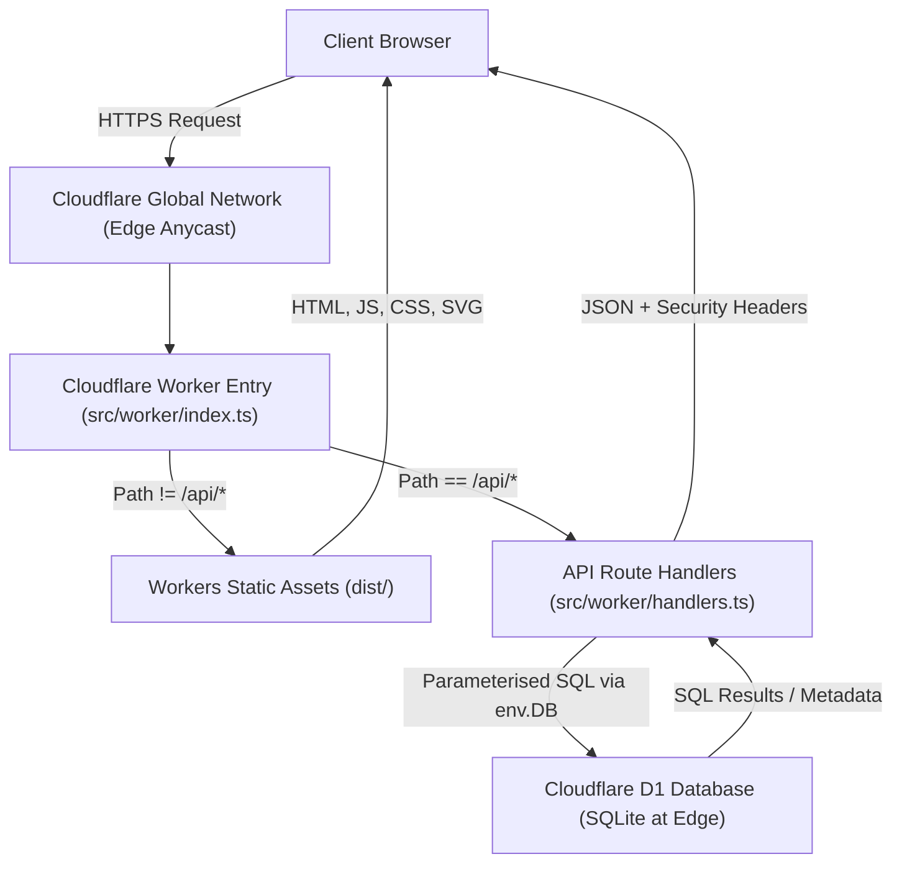
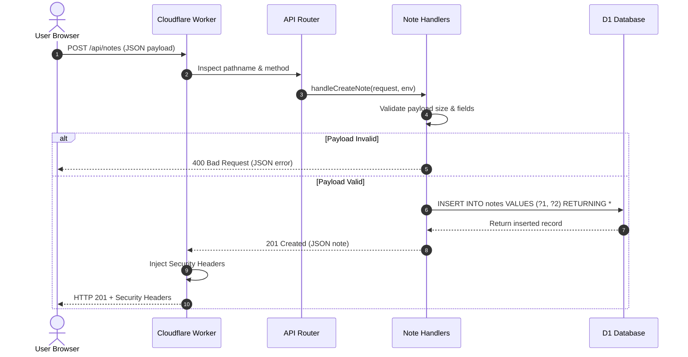
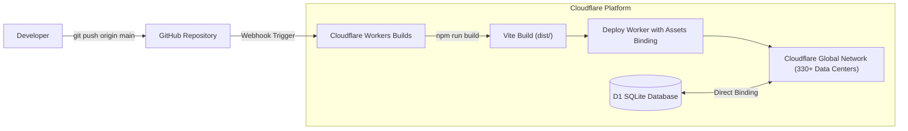

# CloudNotes Architecture Specification

This document details the architectural design, component responsibilities, request lifecycle, and data flow of the **CloudNotes** application deployed on the Cloudflare edge platform.

---

## 1. High-Level System Architecture

The following diagram illustrates how CloudNotes serves both the frontend Single Page Application (SPA) and backend REST API through a single Cloudflare Worker backed by a Cloudflare D1 SQL database.



---

## 2. Component Responsibilities

### A. Frontend (React 18 + Vite + TypeScript)
- **Location:** `src/frontend/`
- **Build Output:** `dist/` (HTML, JS, CSS bundles)
- **Role:**
  - Provides a responsive, accessible SaaS dashboard interface.
  - Manages client-side state for note creation, editing, deletion, search querying, and active modal overlays.
  - Handles debouncing (300ms) for responsive search without saturating the edge network.
  - Formats ISO timestamps into localized dates and human-readable relative time markers ("2 hours ago").
  - Interacts exclusively with `/api/*` endpoints on the **same origin** (no external API URLs or CORS hurdles).

### B. Worker Entry & Edge Router
- **Location:** `src/worker/index.ts`
- **Role:**
  - Serves as the single unified entry point for all incoming HTTP requests to the Worker.
  - Inspects request pathname:
    - If `pathname.startsWith('/api/')`: Dispatches to REST API handlers with method filtering and CORS preflight handling.
    - Otherwise: Invokes `env.ASSETS.fetch(request)` to deliver compiled frontend assets or fallback to `index.html` (SPA routing).
  - Enforces baseline security response headers across all HTTP responses:
    - `X-Content-Type-Options: nosniff`
    - `X-Frame-Options: DENY`
    - `Referrer-Policy: strict-origin-when-cross-origin`
    - `Permissions-Policy: camera=(), microphone=(), geolocation=()`

### C. REST API Handlers
- **Location:** `src/worker/handlers.ts` & `src/worker/helpers.ts`
- **Role:**
  - Validates request payloads and enforces input constraints:
    - Maximum body size: 100 KB
    - Maximum title length: 500 characters
    - Maximum content length: 100,000 characters
    - ID route parameter integer parsing and positivity validation
  - Constructs parameterised SQL statements using the D1 binding (`env.DB`).
  - Maps database query results and errors into structured JSON responses with appropriate HTTP status codes (`200`, `201`, `400`, `404`, `405`, `500`).

### D. Cloudflare D1 Database
- **Role:**
  - Fully managed, serverless relational database built on SQLite.
  - Replicated read performance with zero connection pools or TCP socket handshakes required from the Worker.
  - Enforces schema rules and column constraints (`CHECK(length(title) > 0)`).
  - Maintained through versioned migrations in the `/migrations` directory.

---

## 3. Frontend-to-Backend Request Flow

The sequence diagram below shows the interaction during a note creation request:



---

## 4. Worker-to-D1 Database Communication

Cloudflare D1 is integrated into the Worker execution environment through **environment bindings**. Unlike traditional databases (such as PostgreSQL or MySQL on AWS RDS) that require TCP connection pools, SSL negotiation, credentials, and connection management, D1 uses an internal, high-speed V8 binding:

1. **No Credentials in Code:** The Worker configuration (`wrangler.jsonc`) declares:
   ```jsonc
   "d1_databases": [
     {
       "binding": "DB",
       "database_name": "cloudnotes-db",
       "database_id": "65cab318-7d0d-4c7d-999e-64b18335869c"
     }
   ]
   ```
2. **Direct API Access:** Inside Worker code, `env.DB` provides asynchronous query methods:
   - `env.DB.prepare(sql).bind(...params).all()` — Returns all matching rows.
   - `env.DB.prepare(sql).bind(...params).first()` — Returns the first matching row or null.
   - `env.DB.prepare(sql).bind(...params).run()` — Executes mutation queries and returns metadata (`changes`, `duration`).
3. **Parameterised Statements:** Values are passed into `.bind(...)` rather than string concatenation, ensuring SQL injection is impossible.

---

## 5. Deployment Architecture

CloudNotes leverages **Cloudflare Workers Builds** directly integrated with the GitHub repository:



### Continuous Delivery Workflow:
1. Developer pushes commits to the `main` branch on GitHub.
2. Cloudflare Workers Builds receives the commit webhook.
3. Workers Builds installs dependencies, executes `npm run build`, packages the Worker code and `dist/` directory, and deploys the unified Worker bundle globally.
4. The deployment becomes live within seconds across Cloudflare's entire edge network.
